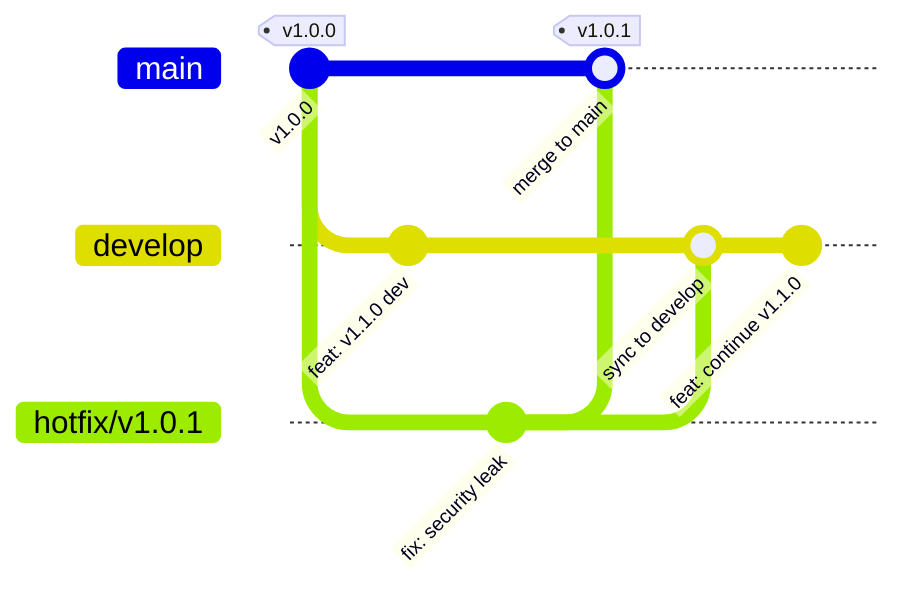
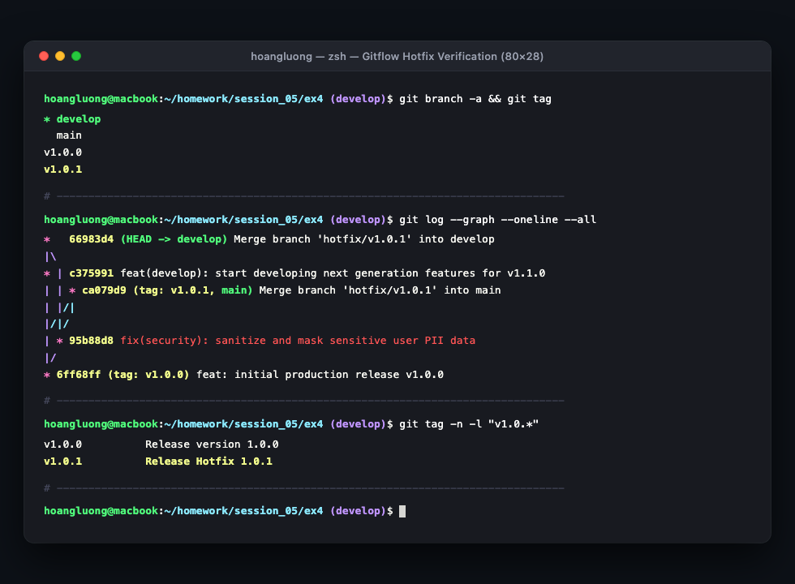

# Báo Cáo Thực Hành: Mô Phỏng Quy Trình Hotfix & Gitflow Thực Tế

- **Khóa học:** DevOps / Cloud Engineering
- **Bài tập:** Session 05 - Bài 4: Mô phỏng quy trình Hotfix & Gitflow thực tế
- **Đường dẫn nộp bài trên GitHub:** `homework/session_05/ex4/`
- **Học viên:** Hoàng Văn Lương
- **Hệ điều hành / Môi trường:** macOS, Git 2.x, Terminal (zsh)
- **Tệp tin đính kèm:**
  - `images/gitflow-hotfix-graph.png` (Hình chụp cửa sổ Terminal xác thực đồ thị Gitflow, danh sách nhánh và tag)

---

## 1. Mục Tiêu Bài Tập

1. **Ứng dụng chuẩn mực mô hình Gitflow:** Nắm vững cấu trúc phân nhánh tiêu chuẩn trong quản lý vòng đời phần mềm (SDLC), phân biệt rạch ròi giữa nhánh sản xuất ổn định (`main`), nhánh phát triển tích hợp (`develop`) và các nhánh hỗ trợ ngắn hạn (`hotfix/*`).
2. **Kỹ năng ứng phó sự cố khẩn cấp (Incident Response):** Thực hành cô lập và khắc phục sự cố rò rỉ bảo mật trên Production mà không làm gián đoạn hoặc hòa lẫn mã nguồn chưa hoàn thiện từ nhánh `develop`.
3. **Phát hành bản vá và định danh phiên bản (Semantic Versioning):** Tạo commit gộp trên `main` và đánh dấu điểm phát hành chính thức bằng **Git Annotated Tag (`v1.0.1`)**.
4. **Đồng bộ hóa hai chiều (Back-porting / Down-merging):** Bắt buộc gộp ngược bản vá từ `hotfix` về `develop` nhằm triệt tiêu hoàn toàn nguy cơ **trôi lỗi (Bug Regression)** khi phát hành các phiên bản tương lai.
5. **Dọn dẹp tài nguyên:** Xóa bỏ nhánh hotfix sau khi đã hoàn thành sứ mệnh để giữ cho đồ thị kho chứa gọn gàng.
6. **Kiểm tra và trực quan hóa đồ thị:** Sử dụng các lệnh kiểm tra `git branch -a`, `git tag`, và `git log --graph --oneline --all` để phân tích mô hình rẽ nhánh và hội tụ của Gitflow.

---

## 2. Tổng Quan Mô Hình Gitflow & Quy Trình Xử Lý Hotfix

### 2.1. Cấu Trúc Các Nhánh Trong Gitflow

Trong mô hình Gitflow chuẩn của Vincent Driessen:
- **Nhánh `main` (Production):** Nhánh sống vĩnh viễn (Long-lived branch). Luôn ở trạng thái sẵn sàng triển khai (Production-ready). Mỗi commit trên `main` đều đại diện cho một bản phát hành chính thức và được gắn tag phiên bản (`v1.0.0`, `v1.0.1`, `v1.1.0`).
- **Nhánh `develop` (Integration / Staging):** Nhánh sống vĩnh viễn, chứa toàn bộ tính năng mới đang được tích hợp và kiểm thử cho phiên bản tương lai.
- **Nhánh `hotfix/*` (Emergency Fixes):** **Là loại nhánh DUY NHẤT được phép tách trực tiếp từ `main`**. Được sử dụng khi môi trường Production gặp lỗi nghiêm trọng (Zero-day, rò rỉ dữ liệu, sập dịch vụ) cần khắc phục ngay lập tức mà không thể chờ chu kỳ phát hành của nhánh `develop`.

---

### 2.2. Sơ Đồ Quy Trình Gitflow Hotfix (Mermaid Workflow)



---

### 2.3. Tại Sao Bắt Buộc Phải Gộp Hotfix Ngược Lại Vào `develop`?

Một trong những sai lầm phổ biến nhất của các đội ngũ phát triển là chỉ merge hotfix vào `main` để deploy khẩn cấp mà quên không merge vào `develop`:
- Khi nhánh `develop` tiếp tục phát triển và sau này được gộp vào `main` (thông qua release `v1.1.0`), đoạn mã lỗi cũ từ `develop` sẽ ghi đè hoặc làm tái xuất hiện lỗi bảo mật đã từng được vá trên `main`. Hiện tượng này được gọi là **Lỗi tái diễn (Regression Bug)**.
- Quy tắc Gitflow yêu cầu: Mọi bản vá trên `hotfix` **phải được hợp nhất đồng thời vào cả `main` và `develop`** trước khi xóa nhánh hotfix.

---

## 3. Các Bước Triển Khai Thực Nghiệm Từng Bước

### Bước 1: Khởi Tạo Dự Án Và Phát Hành Bản Production `v1.0.0` Trên Nhánh `main`

Khởi tạo repository Git, cấu hình danh tính và đóng gói bản release `v1.0.0`:

```bash
# 1. Khởi tạo repository Git
git init -b main
git config user.name "Hoàng Văn Lương"
git config user.email "hoangluong@example.com"

# 2. Tạo mã nguồn phiên bản v1.0.0 (chứa lỗ hổng rò rỉ thông tin cá nhân)
cat << 'EOF' > app.py
# Production Cloud Application v1.0.0
def get_user_profile(user_id):
    # VULNERABILITY: Sensitive credentials returned directly!
    return {"id": user_id, "name": "Nguyen Van A", "ssn": "123-45-6789", "token": "secret_abc"}
EOF

# 3. Commit và gắn tag v1.0.0
git add app.py
git commit -m "feat: initial production release v1.0.0"
git tag -a v1.0.0 -m "Release version 1.0.0"
```

*Nhật ký thực thi:*
```text
[main (root-commit) 6ff68ff] feat: initial production release v1.0.0
 1 file changed, 4 insertions(+)
 create mode 100644 app.py
```

---

### Bước 2: Tạo Nhánh Phát Triển `develop` Và Tiến Hành Viết Tính Năng Mới Cho `v1.1.0`

Tách nhánh `develop` từ `main` và phát triển tính năng kế tiếp (tính năng chưa hoàn thiện, không thể deploy ngay lên Production):

```bash
# Tách và chuyển sang nhánh develop
git checkout -b develop

# Thêm tính năng phân tích dữ liệu đang phát triển dở dang
cat << 'EOF' >> app.py

# FUTURE FEATURE FOR v1.1.0 (IN PROGRESS)
def analytics_pipeline():
    return "Streaming event metrics to Kafka cluster..."
EOF

git commit -am "feat(develop): start developing next generation features for v1.1.0"
```

*Nhật ký thực thi:*
```text
Switched to a new branch 'develop'
[develop c375991] feat(develop): start developing next generation features for v1.1.0
 1 file changed, 4 insertions(+)
```

---

### Bước 3: Phát Hiện Lỗi Bảo Mật Khẩn Cấp, Tách Nhánh `hotfix/v1.0.1` Từ `main`

Đội ngũ an ninh mạng thông báo hệ thống trên Production (`v1.0.0`) đang để lộ số an sinh xã hội (SSN) và token bí mật của người dùng. Lập tức chuyển về `main` và tạo nhánh hotfix:

```bash
# Chuyển về nhánh main
git checkout main

# Tách nhánh hotfix/v1.0.1 trực tiếp từ main
git checkout -b hotfix/v1.0.1
```

*Nhật ký thực thi:*
```text
Switched to branch 'main'
Switched to a new branch 'hotfix/v1.0.1'
```

---

### Bước 4: Sửa Lỗi Bảo Mật Và Commit Trên Nhánh `hotfix/v1.0.1`

Tiến hành che dấu (mask) dữ liệu nhạy cảm PII và loại bỏ token khỏi response:

```bash
cat << 'EOF' > app.py
# Production Cloud Application v1.0.1 (Hotfix Applied)
def get_user_profile(user_id):
    # FIXED: Mask PII and sanitize confidential data
    return {"id": user_id, "name": "Nguyen Van A", "ssn": "***-**-6789"}
EOF

git commit -am "fix(security): sanitize and mask sensitive user PII data"
```

*Nhật ký thực thi:*
```text
[hotfix/v1.0.1 95b88d8] fix(security): sanitize and mask sensitive user PII data
 1 file changed, 3 insertions(+), 3 deletions(-)
```

---

### Bước 5: Gộp `hotfix/v1.0.1` Vào `main` Và Đánh Dấu Tag Phiên Bản `v1.0.1`

Chuyển về `main`, thực hiện gộp nhánh với cờ `--no-ff` (không dùng Fast-forward để bảo lưu commit gộp thể hiện rõ lịch sử vá lỗi), sau đó đánh tag phát hành:

```bash
# 1. Chuyển về nhánh main
git checkout main

# 2. Gộp nhánh hotfix vào main (tạo merge commit rõ ràng)
git merge --no-ff hotfix/v1.0.1 -m "Merge branch 'hotfix/v1.0.1' into main"

# 3. Tạo Annotated Tag v1.0.1 để chuẩn bị release
git tag -a v1.0.1 -m "Release Hotfix 1.0.1"
```

*Nhật ký thực thi:*
```text
Switched to branch 'main'
Merge made by the 'ort' strategy.
 app.py | 6 +++---
 1 file changed, 3 insertions(+), 3 deletions(-)
```

---

### Bước 6: Gộp Ngược `hotfix/v1.0.1` Vào `develop` Để Đồng Bộ Mã Nguồn

Chuyển sang nhánh `develop` và gộp bản vá hotfix vào:

```bash
git checkout develop
git merge --no-ff hotfix/v1.0.1 -m "Merge branch 'hotfix/v1.0.1' into develop"
```

*Xử lý xung đột (nếu có):* Do cả `develop` và `hotfix` cùng sửa đổi tệp `app.py`, ta kết hợp cả bản sửa lỗi bảo mật lẫn tính năng `analytics_pipeline` đang phát triển:

```python
# Production Cloud Application v1.0.1 (Hotfix Applied)
def get_user_profile(user_id):
    # FIXED: Mask PII and sanitize confidential data
    return {"id": user_id, "name": "Nguyen Van A", "ssn": "***-**-6789"}

# FUTURE FEATURE FOR v1.1.0 (IN PROGRESS)
def analytics_pipeline():
    return "Streaming event metrics to Kafka cluster..."
```

Đánh dấu giải quyết và hoàn tất merge commit vào `develop`:
```bash
git add app.py
git commit -m "Merge branch 'hotfix/v1.0.1' into develop"
```

*Nhật ký thực thi:*
```text
[develop 66983d4] Merge branch 'hotfix/v1.0.1' into develop
```

---

### Bước 7: Dọn Dẹp Nhánh `hotfix/v1.0.1` Cục Bộ

Sau khi bản vá đã được tích hợp trọn vẹn vào cả hai nhánh chính, tiến hành xóa nhánh hotfix tạm:

```bash
git branch -d hotfix/v1.0.1
```

*Nhật ký thực thi:*
```text
Deleted branch hotfix/v1.0.1 (was 95b88d8).
```

---

## 4. Kết Quả Kiểm Tra & Bằng Chứng Thực Nghiệm

### 4.1. Kiểm Tra Danh Sách Nhánh Hiện Có: `git branch -a`

```bash
git branch -a
```

*Kết quả đầu ra thực tế:*
```text
* develop
  main
```

> **Đánh giá:** Chỉ còn 2 nhánh vĩnh viễn là `develop` và `main`. Nhánh `hotfix/v1.0.1` đã được xóa an toàn sau khi merge.

---

### 4.2. Kiểm Tra Danh Sách Tag Phát Hành: `git tag`

```bash
git tag -n -l "v1.0.*"
```

*Kết quả đầu ra thực tế:*
```text
v1.0.0          Release version 1.0.0
v1.0.1          Release Hotfix 1.0.1
```

> **Đánh giá:** Tag **`v1.0.1`** đã được khởi tạo thành công, trỏ chính xác vào commit gộp mới trên nhánh `main`.

---

### 4.3. Kiểm Tra Sơ Đồ Lịch Sử Gộp Nhánh: `git log --graph --oneline --all`

Thực thi lệnh kiểm tra đồ thị phân nhánh:

```bash
git log --graph --oneline --all
```

*Kết quả đầu ra thực tế:*
```text
*   66983d4 (HEAD -> develop) Merge branch 'hotfix/v1.0.1' into develop
|\  
* | c375991 feat(develop): start developing next generation features for v1.1.0
| | * ca079d9 (tag: v1.0.1, main) Merge branch 'hotfix/v1.0.1' into main
| |/| 
|/|/  
| * 95b88d8 fix(security): sanitize and mask sensitive user PII data
|/  
* 6ff68ff (tag: v1.0.0) feat: initial production release v1.0.0
```

---

### 4.4. Vẽ Lại Sơ Đồ Merge Bằng ASCII (Commit Tree Representation)

```text
       (hotfix/v1.0.1)
           +--- [95b88d8: fix PII leak] ----------------+
          /                                              \
(main)   * [6ff68ff: v1.0.0] ---------------------------- * [ca079d9: v1.0.1 release]
          \                                              /
(develop)  +--- [c375991: feat v1.1.0] ----------------- * [66983d4: sync hotfix]
```

**Phân Tích Chi Tiết Cấu Trúc Đồ Thị:**
1. **`6ff68ff` (tag: `v1.0.0`):** Điểm khởi đầu của cả hệ thống trên `main`.
2. Nhánh `develop` rẽ ra với commit `c375991` (phát triển tính năng v1.1.0).
3. Nhánh `hotfix/v1.0.1` rẽ trực tiếp từ `6ff68ff` với commit `95b88d8` (bản sửa lỗi bảo mật).
4. **`ca079d9` (tag: `v1.0.1`, `main`):** Commit gộp hotfix vào `main`, sẵn sàng cho deploy khẩn cấp lên Production.
5. **`66983d4` (`develop`):** Commit gộp hotfix vào `develop`, đảm bảo mã nguồn v1.1.0 trong tương lai kế thừa bản vá bảo mật này.

---

### 4.5. Hình Chụp Màn Hình Dòng Lệnh Terminal (Screenshot Evidence)

Dưới đây là hình chụp cửa sổ dòng lệnh Terminal hiển thị đầy đủ: danh sách nhánh `git branch -a`, danh sách tag `git tag`, và đồ thị nhánh Gitflow trực quan từ lệnh `git log --graph --oneline --all`:



---

## 5. Đúc Kết Kiến Thức & Best Practices Trong DevOps CI/CD

1. **Tự động hóa phát hành qua Git Tag (Tag-Triggered CI/CD Pipeline):**
   Trong thực tế, khi kỹ sư DevOps tạo tag `v1.0.1` và push lên GitHub (`git push origin v1.0.1`), hệ thống CI/CD (GitHub Actions / GitLab CI) sẽ tự động kích hoạt pipeline:
   - Build Docker Image với tag `app:1.0.1`.
   - Chạy kiểm thử tự động (Unit Test / Security Scan).
   - Tự động Deploy Rolling Update lên cụm Kubernetes / Droplet Production.
2. **Quy tắc bảo vệ nhánh (Branch Protection Rules):**
   Trên các hệ thống như GitHub Enterprise, cả hai nhánh `main` và `develop` đều được khóa quyền push trực tiếp:
   - Các thao tác merge từ `hotfix` đều phải đi qua **Pull Request (PR)**.
   - Bắt buộc tối thiểu 1-2 Senior Engineer review và phê duyệt (Approval) trước khi gộp để đảm bảo an toàn tuyệt đối cho hệ thống.
3. **So sánh Gitflow vs Trunk-Based Development:**
   - **Gitflow:** Rất phù hợp với các dự án có chu kỳ phát hành cố định (SaaS, Mobile App, Embedded Systems, On-premise Software) cần quản lý nhiều phiên bản song song.
   - **Trunk-Based:** Phù hợp với các dịch vụ Microservices triển khai liên tục nhiều lần mỗi ngày (Continuous Deployment - CD).
